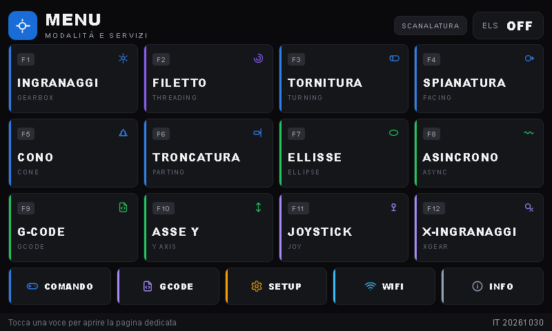
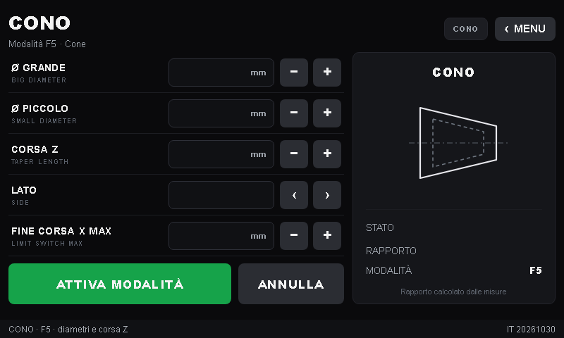
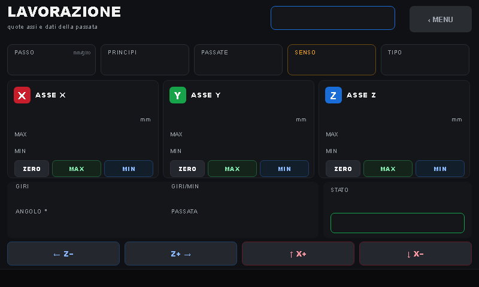

# NanoEls H5

Controller **ELS** (Electronic Lead Screw) per tornio, basato su **ESP32-S3**, con
interfaccia su display **Nextion H5 da 800×480** e una **UI web** integrata per
configurazione, programmi G-code e aggiornamenti.

Deriva dal progetto [NanoEls](https://github.com/kachurovskiy/nanoels) di Maxim
Kachurovskiy (licenza MIT); questa variante aggiunge l'interfaccia H5, la grafica
TFT a card, l'avvio della lavorazione in un tocco e la gestione OTA di firmware e
display.

> Il progetto è in fase di rifinitura. Il firmware compila, gira sul controller e
> l'interfaccia è verificata; restano da completare le prove fisiche sul tornio
> (vedi [Stato del progetto](#stato-del-progetto)) prima della pubblicazione.

## Caratteristiche

- **13 modalità di lavoro**: ingranaggi, X-ingranaggi, tornitura, spianatura,
  cono, troncatura, filettatura (anche a più principi e conica), ellisse,
  asincrono, asse Y, joystick, scanalatura, G-code.
- **Display Nextion 800×480**: 21 pagine a card, valori live dipinti dal firmware,
  tastierino numerico e tastiera testuale sul pannello.
- **Pagina LAVORAZIONE**: apre da sola la lavorazione in corso; `STATO/AVVIA`
  conferma il setup già impostato e parte in un tocco.
- **UI web** (`http://<ip-del-controller>/`): quote, finecorsa, parametri motori,
  WiFi, programmi G-code anche da file `.gcode`, backup e ripristino della
  configurazione macchina, riavvio del controller, aggiornamento firmware e TFT
  via OTA.
- **Sicurezza di lavoro**: STOP immediato, emergenze con messaggio a schermo,
  finecorsa obbligatori nelle modalità che li richiedono.
- **Impostazioni persistenti** in NVS: assi, finecorsa, passo, rapporto cono,
  WiFi (la password non viene mai mostrata: campi mascherati e vuoti).
- **Hardware opzionale**: volantini, joystick, tastiera PS/2.

## Immagini

| Menu | Cono | Lavorazione |
|---|---|---|
|  |  |  |

## Hardware

- **MCU**: ESP32-S3, 4 MB di flash (partizione `min_spiffs`), PSRAM non richiesta.
- **Display**: Nextion H5 800×480 collegato in seriale (115200 baud; primo upload a
  9600).
- **Mandrino**: encoder ottico (default 1200 impulsi/giro) su GPIO 13/14.
- **Assi**: due driver passo-passo (Z e trasversale X), finecorsa Z e X.
- **Ingressi opzionali**: volantini, joystick, tastiera PS/2.

I pin e i valori di default (passo viti, passi/giro, invert, corse massime) stanno
in testa a [`firmware-it/h5/h5.ino`](firmware-it/h5/h5.ino) e si possono
sovrascrivere dalla UI web senza ricompilare.

## Struttura del repository

```
firmware-it/h5/          firmware ESP32-S3 (h5.ino)
firmware-it/*.bin        firmware compilati per l'aggiornamento OTA
screen-it/h5_it.HMI      progetto Nextion Editor (pagine, immagini, eventi)
screen-it/h5_it.tft      interfaccia compilata per il display
screen-it/*.png          sfondi 800x480 delle pagine
screen-it/MANUALE_USO.md          manuale d'uso
screen-it/TABELLA_PAGINE_MENU.md  mappa pagine, ID e script eventi
screen-it/TABELLA_COMPONENTI.md   componenti e zone touch
screen-it/GUIDA_NEXTION_EDITOR.md guida alla modifica dell'interfaccia
mockup-tft/              mockup e sorgenti grafiche delle schermate
gui/                     script di supporto (generazione asset, prove)
collaudo/                procedure di collaudo sicurezza (STOP, ESTOP, reset)
targhetta/, cablaggio/   targhetta e schema dei connettori
```

## Compilare il firmware

Serve [arduino-cli](https://arduino.github.io/arduino-cli/) con il core ESP32 di
Espressif 3.x e due librerie:

```sh
arduino-cli core update-index --additional-urls https://espressif.github.io/arduino-esp32/package_esp32_index.json
arduino-cli core install esp32:esp32 --additional-urls https://espressif.github.io/arduino-esp32/package_esp32_index.json
arduino-cli lib install "WebSockets" "PS2KeyAdvanced"

arduino-cli compile \
  --fqbn "esp32:esp32:esp32s3:FlashSize=4M,PartitionScheme=min_spiffs,PSRAM=disabled" \
  firmware-it/h5
```

Il binario prodotto è `firmware-it/h5/build/h5.ino.bin`, da caricare come descritto
sotto. In alternativa si apre `firmware-it/h5/h5.ino` con l'Arduino IDE (scheda
*ESP32S3 Dev Module*, 4 MB flash, `min_spiffs`, PSRAM disabilitata).

## Caricare firmware e interfaccia

1. **Firmware** (`.bin`): dalla UI web, *Aggiorna firmware*. Il controller deve
   essere spento (`ELS OFF`); al termine si riavvia da solo.
2. **Display** (`.tft`): dalla UI web, *Aggiorna display Nextion*, oppure copiando
   `h5_it.tft` sulla microSD come `h5.tft` (FAT32, radice) e riavviando il display.
   La UI web usa 115200 baud; per un display di fabbrica o al primo caricamento
   va spuntata la casella *Primo caricamento (9600 baud)*.

## Primo avvio

1. Accendere il controller: se non c'è un WiFi salvato, o la connessione alla rete
   di casa fallisce, si apre l'access point **`NanoEls-H5-Setup`** con password
   **`nanoels-h5`**.
2. Collegarsi e aprire `http://192.168.4.1/`, impostare SSID e password della rete
   di casa e salvare; il controller si riavvia.
3. Aprire la UI web all'indirizzo mostrato nella pagina INFO/WIFI del display e
   impostare quote, finecorsa e parametri degli assi.

## Documentazione

- [Manuale d'uso](screen-it/MANUALE_USO.md) — modalità, procedure passo-passo,
  messaggi, emergenze.
- [Montaggio sul tornio](MONTAGGIO_TORNIO.md) — checklist dal banco alla macchina:
  cablaggio, parametri, verifiche a vuoto e prove di lavorazione.
- [Mappa delle pagine](screen-it/TABELLA_PAGINE_MENU.md) — pagine, ID, script.
- [Componenti e zone touch](screen-it/TABELLA_COMPONENTI.md).
- [Guida a Nextion Editor](screen-it/GUIDA_NEXTION_EDITOR.md).

## Stato del progetto

Verificato:

- compilazione e avvio su ESP32-S3 (firmware H5V65);
- 21 pagine TFT: sfondi, colori, zone touch, valori dipinti dal firmware;
- logica di setup e avvio in un tocco per tutte le modalità;
- aggiornamento OTA di firmware e display;
- caricamento di programmi G-code da file nella UI web;
- UI web (configurazione, G-code, WiFi) e persistenza in NVS;
- STOP normali verificati a banco (controller senza assi montati).

Da completare prima della pubblicazione:

- prove fisiche sul tornio: sincronizzazione Z/X, finecorsa, mandrino, passate,
  filettatura anche conica;
- verifica dei valori live durante una lavorazione reale;
- collaudo sicurezza a macchina montata: emergenza durante il jog, reset
  generale, STOP di un programma G-code;
- prova su una seconda macchina/configurazione.

## Sicurezza

- La UI web **non ha login**: usarla solo su una rete locale di fiducia.
- L'access point di setup ha una password nota (`nanoels-h5`), pensata per la
  configurazione iniziale; non va lasciato attivo su reti pubbliche.
- Il controller comanda motori: prima di ogni prova togliere l'utensile dal pezzo
  e tenere a portata di mano lo STOP.

## Licenza

[MIT](LICENSE). Il progetto deriva da NanoEls di Maxim Kachurovskiy (MIT, 2020):
la nota di copyright originale è mantenuta.

## Sostieni il progetto

Il progetto è libero e gratuito, senza funzioni a pagamento. Se ti è utile e vuoi
offrirmi un caffè, il link per le donazioni sarà inserito qui prima della
pubblicazione:

<!-- TODO: inserire qui il link "offrimi un caffè" (Buy Me a Coffee / Ko-fi) -->
_link donazioni in arrivo_

## Crediti

- Maxim Kachurovskiy — progetto [NanoEls](https://github.com/kachurovskiy/nanoels).
- Nextion — display e Nextion Editor.
- Comunità Arduino/ESP32 per le librerie utilizzate.
